<div align="center">

# ⚡ Verve

**A native, GPU-accelerated developer workbench built with Rust + GPUI — unifying API debugging, traffic capture, an SSH/SFTP terminal (jump host / port forwarding), Docker & K8s log inspection, stress & automated testing, mock, a Markdown notes editor, hosts and JSON tools in a single window.**

### A native developer workbench

Verve is built on **Rust + [GPUI](https://github.com/zed-industries/zed)** (the same GPU-accelerated UI framework that powers the Zed editor) — not Electron. The whole app is rendered on the GPU, starts in under a second, and stays well under 100 MB of RAM, so it stays responsive even while streaming container logs or running a load test.

`API & Testing` · `Terminal & Triage` · `Mock & Capture` · `Docs & Git` · `Notes` · `Hosts` · `JSON`

<br/>

<a href="https://aios-pub.github.io/verve/">
  
</a>
<a href="https://github.com/aios-pub/verve/releases/latest">
  
</a>
<a href="https://github.com/aios-pub/verve">
  
</a>

<br/>

> 🚫 **Stop juggling Postman + an SSH client like Termius + Swagger + a notes app + a Markdown editor like MarkText + a JSON formatter + a hosts editor…**
> Verve absorbs the high-frequency dev workflow into one native window — built in Rust + GPUI for developers who refuse to settle for sluggish Electron bloat.

<br/>

<table>
  <tr>
    <td align="center"><b>🦀 Rust + GPUI</b><br/><sub>GPU rendering, no Chromium</sub></td>
    <td align="center"><b>⚡ &lt;1s Startup</b><br/><sub>Instant launch</sub></td>
    <td align="center"><b>💾 &lt;100MB RAM</b><br/><sub>5× lighter</sub></td>
    <td align="center"><b>🔒 Offline-First</b><br/><sub>Your data stays local</sub></td>
    <td align="center"><b>🖥️ Cross-Platform</b><br/><sub>macOS · Linux · Windows</sub></td>
  </tr>
</table>

<br/>

[Features](#-features) · [Getting Started](#-getting-started) · [License](#-license)

</div>

---

## 🦀 Built with Rust + GPUI — Why It Matters

Verve is built in **Rust** and rendered with **[GPUI](https://github.com/zed-industries/zed)** — the same GPU-accelerated framework that powers the Zed editor. No Electron, no Chromium. Here's the real-world difference:

| | Verve (Rust + GPUI) | Electron-based tools |
|---|---|---|
| ⚡ **Startup** | < 1 second | 3–5 seconds |
| 💾 **Memory** | < 100 MB | 500 MB+ |
| 🎨 **Rendering** | Native GPU, ~60fps | Chromium software compositing |
| 🛡️ **Safety** | Memory-safe, zero-cost abstraction | GC pauses, V8 overhead |

What this means for you: instant responses when debugging APIs, fluid terminals under heavy load, and a battery-friendly footprint that stays light all day.

---

## 🆍 100% Free & Open-Source

Verve is **fully open source under AGPL-3.0** — every feature ships in a single free edition, with no paid tier and no feature gates. That includes everything from daily API debugging to the professional toolset: container & cluster inspection (**Docker / Kubernetes**), **stress testing** and **automated test suites**, the **Markdown notes & file editor**, and **cloud document sharing** via a self-hosted `verve-server`. Download a release or build from source — both give you the complete tool.

---


## ✨ Features

### 🔌 API Debugging
<div align="center">
  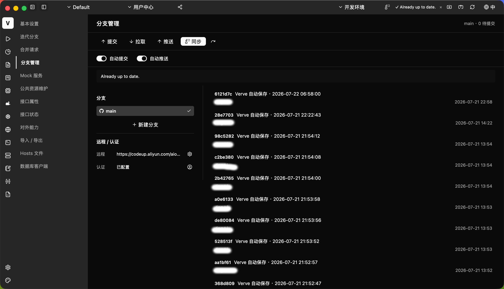
  <br/>
  <em>Project tree (multi-level nesting)</em>
</div>
<div align="center">
  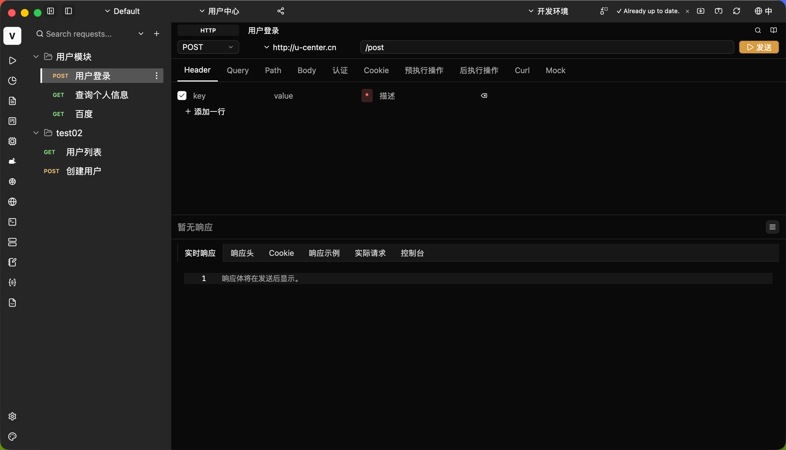
  <br/>
  <em>Request editor & response panel</em>
</div>
<div align="center">
  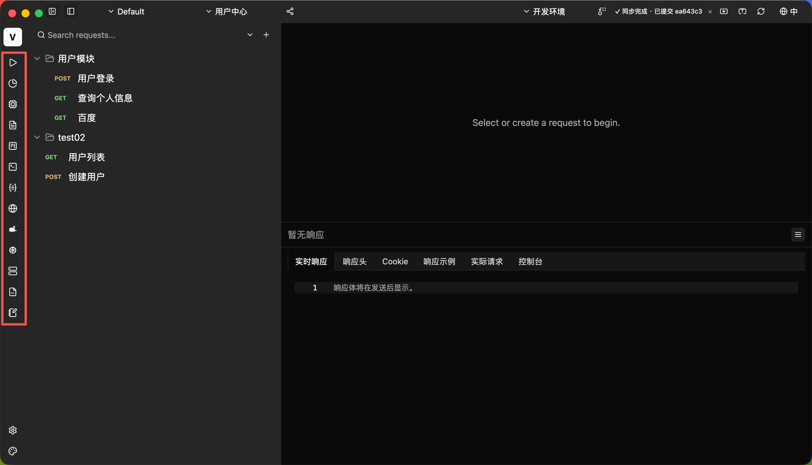
  <br/>
  <em>Drag &amp; drop to reorder the tree</em>
</div>

- Projects → folders → requests tree with multi-level nesting
- Full HTTP methods: `GET POST PUT DELETE PATCH HEAD OPTIONS`
- Request body: none / form-data / x-www-form-urlencoded / raw (JSON / XML / Text / HTML / JS)
- `{{variable}}` placeholder substitution with multi-scope priority (request > folder > environment > global)
- Pre-request & Tests scripts (JavaScript)
- Multi-protocol clients: **HTTP / gRPC (gRPC-Web) / TCP / SSE / WebSocket / Socket.IO**
- Multi-environment variable management (4-scope priority: system < global < environment < folder < request)
- Response panel: status / time / size / headers / body with JSON pretty-print
- API clone, JSON format & validation, history

### 🌐 HTTP Capture Proxy
<div align="center">
  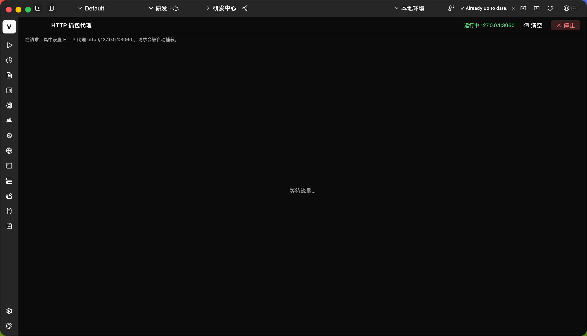
</div>

- Local HTTP forward proxy on `127.0.0.1:<port>`
- Records request + response pairs to an in-memory ring buffer for in-app inspection
- **Plaintext HTTP only — HTTPS / MITM decryption is not supported**

### 🎭 Local Mock Server
<div align="center">
  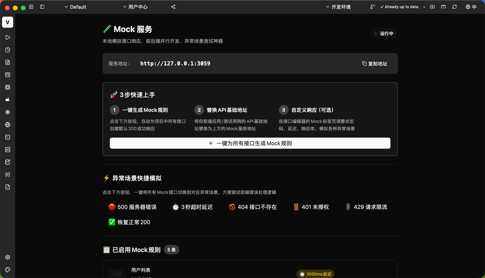
</div>

- Rule-based mock responses served on the unified share server (port 3097)
- Matching by method + path (Exact → Prefix → Regex) + query + headers, priority-ordered; template-variable substitution; one-click default-mock generation

### 📄 Document Sharing (Local)
<div align="center">
  
</div>

- Generate self-contained HTML docs from any project / folder / single request
- Modular layout with field display controls, color-coded parameter tables with required markers
- QR code sharing + link sharing + HTML export
- Strict access control: expiration + password protection (enforced by the local server)
- Field-level display toggles (9 switches: description / params / headers / body / auth / cookies / path / examples / mock)
- Push a project to a self-hosted `verve-server` for a public URL — see [Cloud Sharing](#-self-hosted-verve-server-cloud-sharing)

### 🌍 Git Cross-Machine Sync
<div align="center">
  
</div>

- Multi-workspace support — **each workspace = a git branch** (default workspace → `main`, others → `verve/<id>`)
- Auto-commit + auto-sync every 30 minutes (configurable); commit on workspace switch
- Per-workspace `workspace.json` isolation; machine-local config (SSH hosts, layout, etc.) is git-ignored
- HTTPS remote + username / token (PAT) auth — token never touches disk, argv, or `.git/config` (uses a `GIT_ASKPASS` helper)
- Fast-forward-only sync (`--ff-only`); conflict detection with ours/theirs resolution
- Designed for **single-user cross-machine sync** (e.g. office + home), not concurrent team collaboration
- Works fully offline as a local version history even without a remote configured

### 🔐 SSH Terminal
<div align="center">
  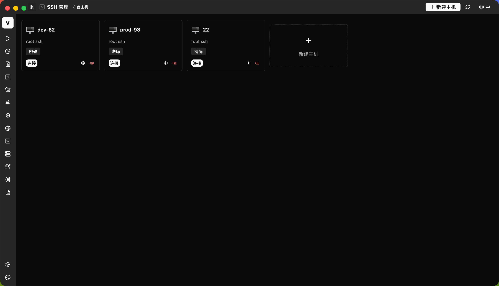
  <br/>
  <em>Host card management (secure credential storage)</em>
</div>
<div align="center">
  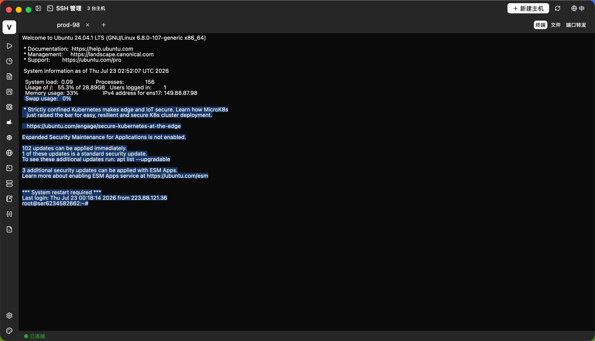
  <br/>
  <em>Multi-tab terminal sessions</em>
</div>

- Connect to Linux servers with **password / private-key** authentication (key passphrase supported)
- Multi-tab terminal sessions (switch / close / persist)
- Built-in terminal emulator — full ANSI / xterm-256color (16-color + 256-color + true color), IME input
- Paste (Cmd/Ctrl+V) · terminal text copy
- **Jump host / bastion** (ProxyJump, chained `direct-tcpip` tunnels)
- TOFU `known_hosts` — first-seen records, re-connect compares, mismatch refused
- Host card management with **secure credential storage** (device-key encrypted vault, AES-256-GCM — no OS keychain prompts, no master password)

> *SSH Agent authentication and remote (`-R`) port forwarding are not implemented yet. This is an SSH client for triage, not a full iTerm2 replacement.*

### 📁 SFTP & File Transfer
<div align="center">
  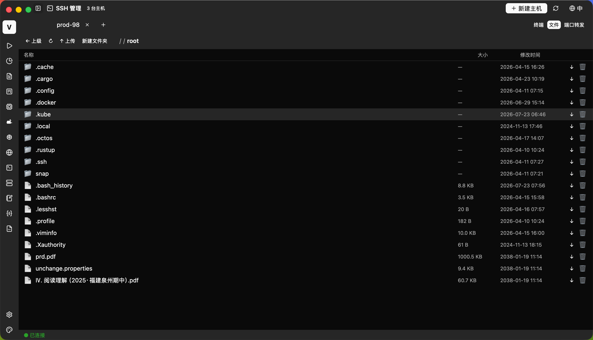
</div>

- SFTP over SSH — list / mkdir / rename / upload / download, recursive directory removal, 64 KiB chunked streaming with progress

### 📁 Zmodem Transfer
- **`rz` / `sz`** file transfer directly inside the terminal — detected via `**\x18B` handshake, no extra setup

### 🔀 SSH Port Forwarding
- **Local port forwarding (`-L`)** — expose an internal service to the API tester with one click

### 🛠️ More Tools
<div align="center">
   &nbsp;
  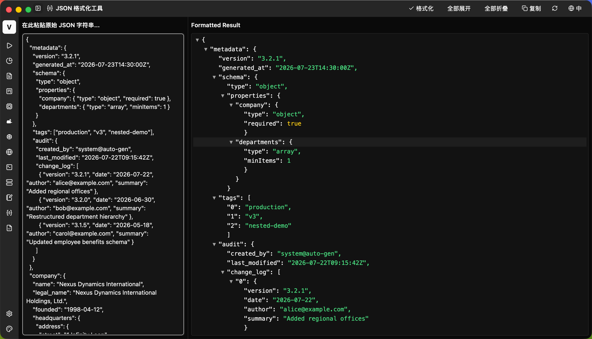
  <br/>
  <em>Hosts manager &nbsp;·&nbsp; JSON format</em>
</div>
<div align="center">
  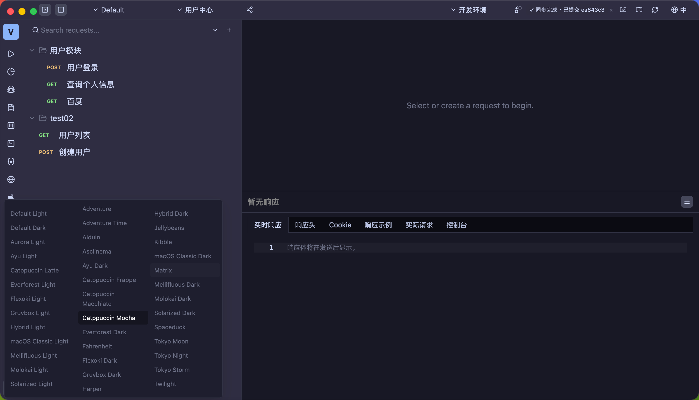
  <br/>
  <em>22 built-in themes</em>
</div>
<div align="center">
  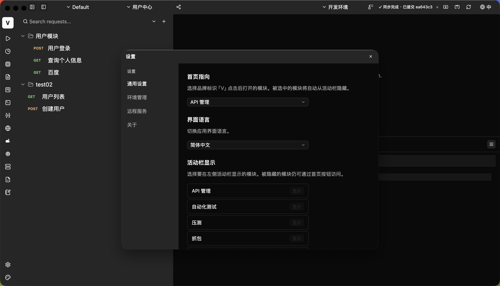
  <br/>
  <em>Settings (i18n, theme, home view, auto-update)</em>
</div>

- **Hosts file manager** — read `/etc/hosts`, manage profiles
- i18n: Simplified Chinese (default) / English
- 22 built-in themes (Catppuccin, Gruvbox, Tokyo Night, Solarized, Everforest, Flexoki…)
- Import: Postman v2.1 / OpenAPI 3 / Swagger 2.0 / Postman 7+ (full format compatibility)
- Export: Markdown / JSON / Postman format (round-trip compatible)
- Configurable home view · Auto-update check · Cross-platform packaging (macOS / Linux / Windows)

---

### 🐳 Docker
<div align="center">
  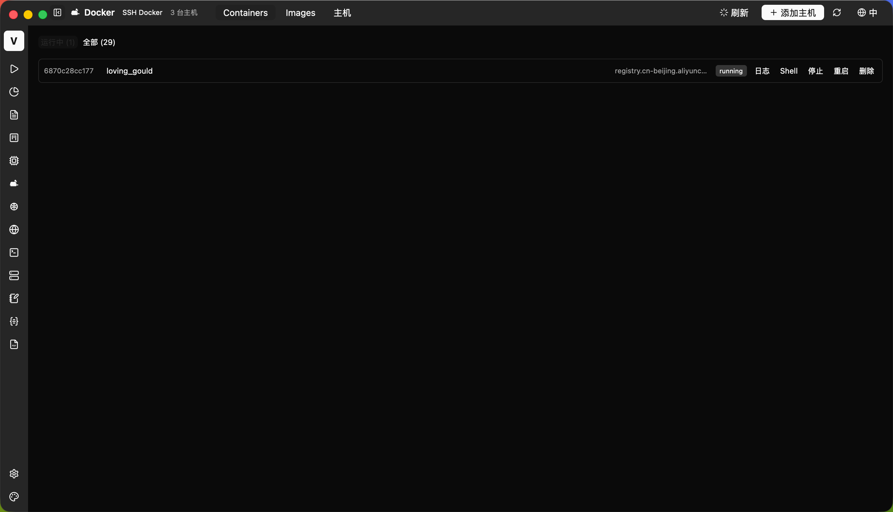
  <br/>
  <em>Containers</em>
</div>
<div align="center">
   &nbsp;
  
  <br/>
  <em>Images &nbsp;·&nbsp; Logs</em>
</div>
<div align="center">
  
  <br/>
  <em>Exec shell (multi-tab)</em>
</div>

- Connect to a **local or remote** Docker daemon (remote via `DOCKER_HOST`, or over an **SSH tunnel** using `docker system dial-stdio`)
- **Containers** — list / start / stop / restart / remove
- **Images** — list / prune unused
- **Logs** — `docker logs -f --tail=N` streaming
- **Exec** — `docker exec -it` with a real PTY (auto-detects bash/sh/dash/ash), multi-tab

> *Focused on log inspection and shell exec. Image build/pull/push, networks, volumes, compose, swarm, and container resource stats are not supported — this is a lightweight triage tool, not a full Docker Desktop replacement.*

### ☸️ Kubernetes
<div align="center">
  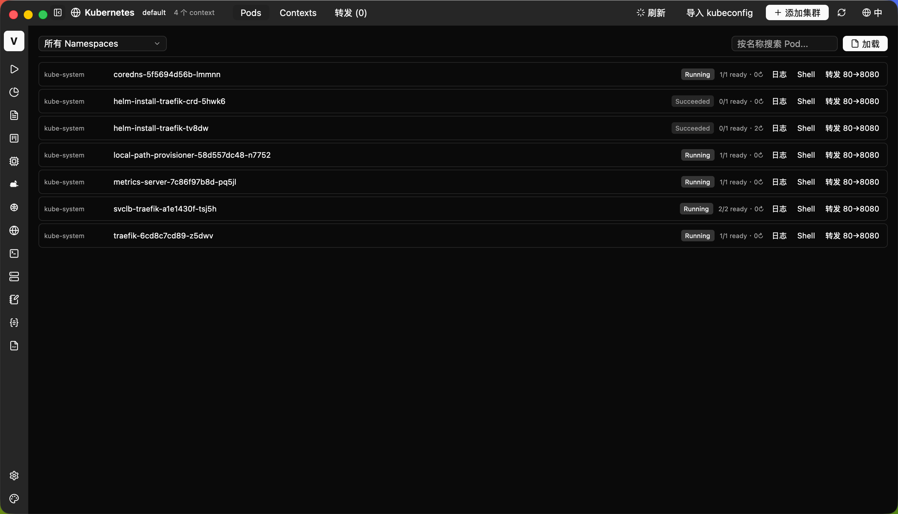
  <br/>
  <em>Pods</em>
</div>
<div align="center">
  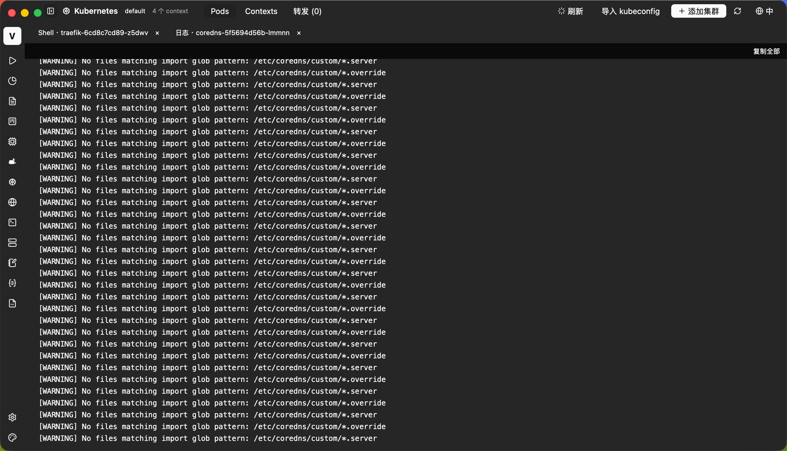 &nbsp;
  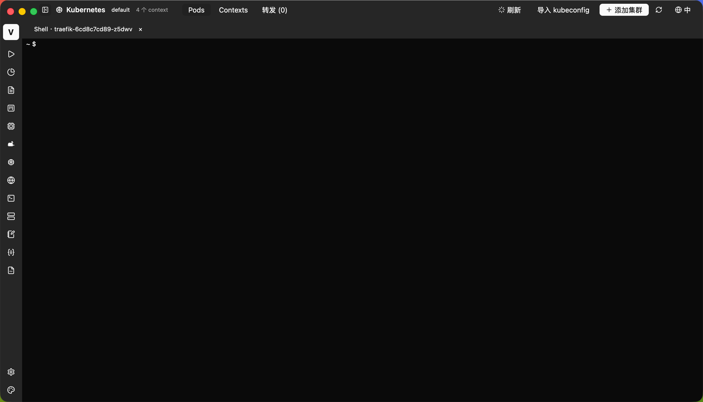
  <br/>
  <em>Logs &nbsp;·&nbsp; Exec shell</em>
</div>

- Parse `~/.kube/config` + Verve-managed kubeconfig, switch context (Token / ClientCert / BasicAuth)
- **Pods & namespaces** — list (with containerStatuses: ready / restartCount), `-A` or scoped to a namespace
- **Logs** — `kubectl logs -f --tail=N [-c container]` streaming
- **Exec** — `kubectl exec -it` with a real PTY
- **Port-forward** — `kubectl port-forward pod/<pod> <local>:<remote>` (auto-allocates a local port)
- Two connection modes: **Direct** (API server) or **SSH tunnel** (via a Verve SSH bastion)

> *Focused on pod-level observation & debugging. Only pods and namespaces are supported — no service/deployment/configmap/ingress/node, no apply/create/delete, no helm/kustomize.*

### ⚡ Stress Testing
<div align="center">
  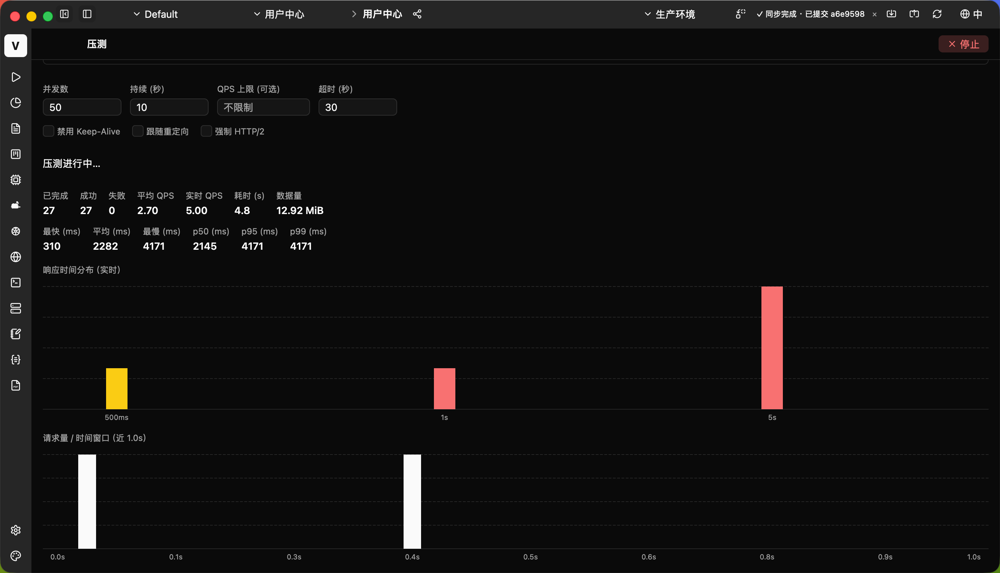
</div>

- **Native load engine** (built on `reqwest`, not an external binary) — concurrency / duration / QPS cap / timeout, keepalive & redirect controls
- **Live chart** — a `StressSnapshot` every 200 ms (window RPS, p50/p90/p95/p99, latency histogram, status-code distribution)
- **Scenario mode** — multiple workers each loop a multi-step TestCase (reuses the autotest runner), per-iteration latency & pass/fail counts

### 🧪 Automated Testing
<div align="center">
  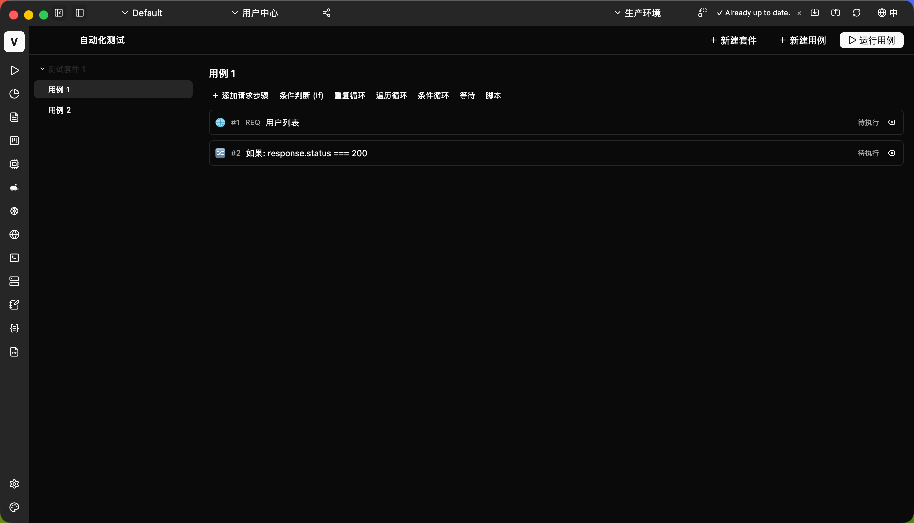
</div>

- **Suite → Case → Step** structure (Postman-Collection-Runner-style), persisted in `workspace.json`
- **Step types**: `Request` (HTTP) · `If` (JS condition → then/else) · `Loop` (Repeat / ForEach over a JSON array / While) · `Wait` · `Script`
- **Assertions** via `apt.assert(condition, message?)` in JavaScript (boa engine); per-step pass/fail counters
- **Variable extractors** — JsonPath (dot-path) · Header · StatusCode · ResponseTime · Body; extracted vars are visible to later steps and across iterations
- **Script API** — `apt.variables` / `apt.environment` / `apt.setVariable` / `apt.assert` / `apt.echo` / `console.log`, with a `response` binding

### 🗒️ Markdown Notes Editor
<div align="center">
  
  <br/>
  <em>Notes with live preview</em>
</div>

- Note tree (folders, pin, tags) with **live preview canvas**
- Export notes to **PDF** (built-in fonts, headings, code blocks, lists, links)
- **Standalone Markdown file editor** — multi-tab, Finder double-click / `verve file.md` (replaces tools like MarkText)

### 📦 Self-hosted `verve-server` (Cloud Sharing)

Verve ships a standalone server binary for hosting shared documents in the cloud, with an admin Web UI for uploading projects and managing share links.

- Binds `0.0.0.0`, file-backed store under `<data>/cloud/`
- **Cloud document sharing** — push a project JSON to the remote server and get a public `/s/<id>` URL (Bearer-token authenticated upload)
- `/admin` Web UI — upload / create / browse / delete shares, multi-tenant isolation
- Shared documents are **read-only snapshots** of the project at upload time

See [`docs/verve-server.md`](./docs/verve-server.md) for the full deployment guide.

---

## 🚀 Getting Started

- **Pre-built binaries**: download the latest build for your platform (macOS / Linux / Windows) from [Releases](../../releases).
- **Build from source**: `git clone` this repo, then `cargo build --release`.
  - **Linux prerequisite**: the GPUI text stack pulls in `freetype-sys` + `fontconfig-sys`, which link the system FreeType/fontconfig via pkg-config, so install their development headers first:
    ```bash
    sudo apt-get install -y \
      build-essential pkg-config gcc g++ clang \
      libssl-dev libfontconfig1-dev libfreetype6-dev \
      libgtk-3-dev libwebkit2gtk-4.1-dev \
      libxkbcommon-x11-dev libx11-xcb-dev libwayland-dev \
      libzstd-dev libvulkan1 vulkan-validationlayers
    ```
    (Or run `./scripts/install-deps.sh`, which picks the right package manager.)
- On first launch, Verve auto-creates its data directory with a demo project so you can explore right away.

---

## 📋 Keyboard Shortcuts

| Shortcut | Action |
|----------|--------|
| `Cmd/Ctrl+Enter` | Send request |
| `Cmd/Ctrl+S` | Save workspace |
| `Cmd/Ctrl+N` | New request |
| `Cmd/Ctrl+V` | Paste (in terminal) |
| `Tab` | Auto-complete (in terminal) |

---

## 💬 Feedback & Issues

Found a bug or have a feature request? Please [open an issue](../../issues/new).

---

## 📄 License

Verve is released under the **AGPL-3.0** open-source license — the whole app, all features, one license. Source code is public; you may use, study, modify, and redistribute it under the terms of AGPL-3.0. Note that AGPL-3.0 is a strong copyleft license: derivative works must be released under AGPL-3.0, and **network use (offering the software as a service over a network) also triggers the source-disclosure obligation.**

The full text of the AGPL-3.0 is in the [`LICENSE`](LICENSE) file at the repository root.

---

## 🔐 Security & Credentials

Verve never stores secrets (SSH passwords, private-key passphrases) in plaintext host config files. Each secret lives in a **device-key encrypted vault** (`~/.verve/ssh_vault.bin`, AES-256-GCM), sealed with an auto-generated per-device key (`~/.verve/device.key`, mode `0600`).

This design gives you a **Termius-like experience: no master password to remember, and no per-access OS keychain authorization dialog** — secrets stay encrypted at rest and isolated per OS user. (Earlier keychain-based builds prompted repeatedly because ad-hoc signatures invalidate the "Always Allow" grant on every rebuild; the vault design sidesteps the keychain entirely.)

Per-module credential sources: SSH uses the encrypted vault; Docker / Kubernetes in SSH-tunnel mode reuse the SSH host's vault secret (tunnels are cached, so the vault is read at most once per host/cluster per app run); Git tokens are kept in memory only and never persisted. Kubernetes API tokens (token / client-cert / basic-auth) are currently stored as plaintext in `kube_clusters.json` and are not yet integrated with the vault.

See [`docs/security.md`](docs/security.md) for the full security model, threat boundary, and migration notes.

---

## ⚠️ Disclaimer

Verve is an ongoing project under active development. **There is no guarantee that every feature described in this document is available, complete, or stable.** Some features may be unimplemented, experimental, or subject to change without notice. **The actual capabilities of the trial build shall prevail.** Please refer to the latest build for the real state of the software.
