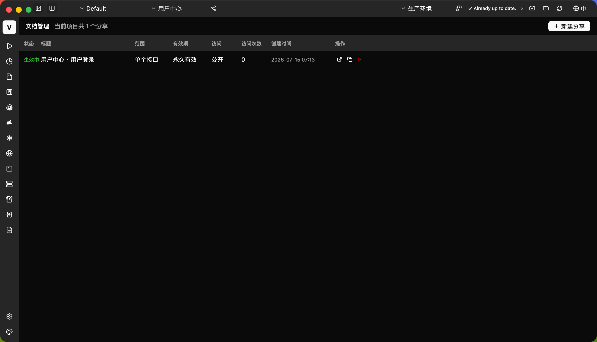
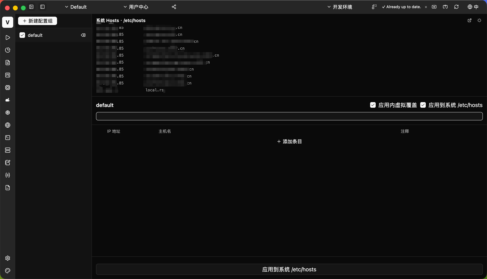
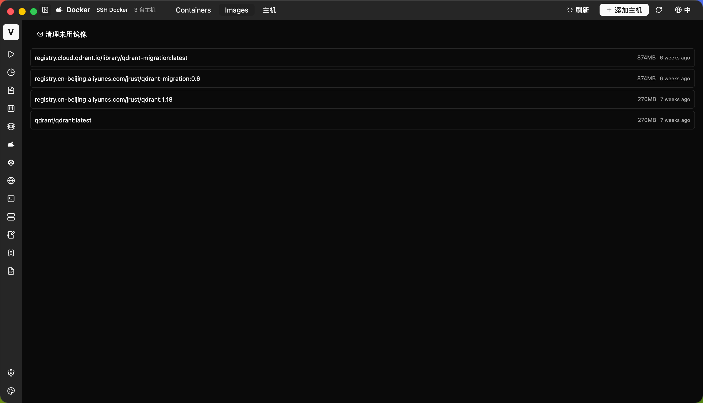
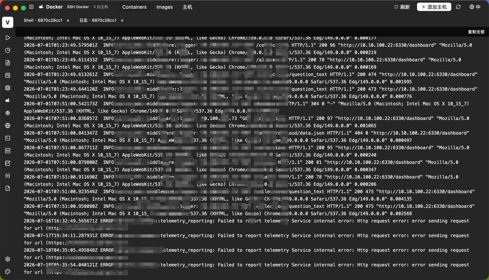
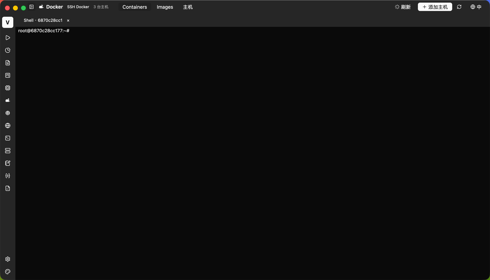
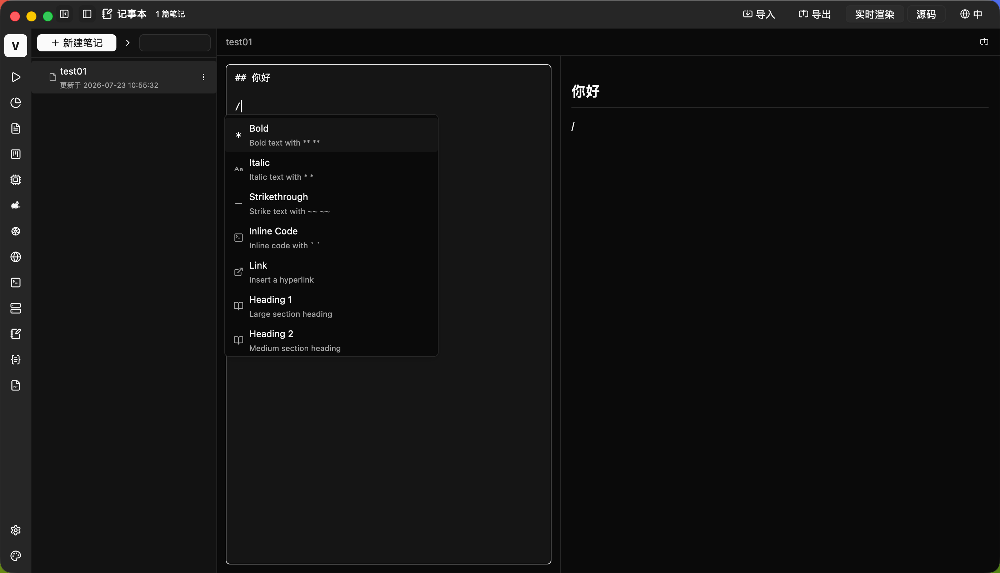
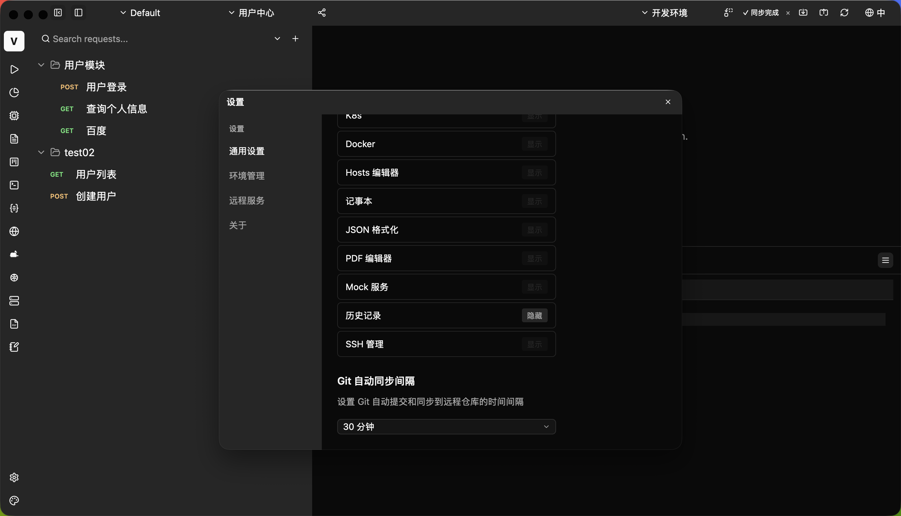

# ⚡ Verve

**An offline-first, one-stop developer workbench built with Rust — unifying API debugging, SSH triage, Docker/K8s log inspection, stress testing, mock & capture, notes, hosts, and JSON tools in a single native window.**

### Open-Source Community Edition + Commercial Pro Edition

Verve ships in **two editions**: a free, open-source **Community Edition** for individual developers' daily API workflow, and a one-time-purchase **Pro Edition** that adds operations, knowledge management, and cloud collaboration on top.

`API & Testing` · `Terminal & Triage` · `Mock & Capture` · `Docs & Git` · `Notes` · `Hosts` · `JSON` · `PDF`

 

> 🚫 **Stop juggling Postman + iTerm2 + Docker Desktop + Swagger + a notes app + a JSON formatter + a hosts editor…**
> Verve is the single native desktop app that absorbs your daily high-frequency dev workflow — built in Rust for developers who refuse to settle for sluggish Electron bloat.

 

<table>
  <tr>
    <td align="center"><b>🦀 Rust-Native</b> No Electron, no Chromium</td>
    <td align="center"><b>⚡ &lt;1s Startup</b> Instant launch</td>
    <td align="center"><b>💾 &lt;100MB RAM</b> 5× lighter</td>
    <td align="center"><b>🔒 Offline-First</b> Your data stays local</td>
    <td align="center"><b>🖥️ Cross-Platform</b> macOS · Linux · Windows</td>
  </tr>
</table>

 

[Features](#-features) · [Community vs Pro](#-community-vs-pro) · [Getting Started](#-getting-started) · [Pro Edition](#-pro-edition--one-time-purchase)

---

## 🦀 Built with Rust — Why It Matters

Verve is built in **Rust** from the ground up. Here's the real-world difference against Electron-based tools:

| | Verve (Rust) | Electron-based tools |
|---|---|---|
| ⚡ **Startup** | < 1 second | 3–5 seconds |
| 💾 **Memory** | < 100 MB | 500 MB+ |
| 🎨 **Rendering** | Native GPU, ~60fps | Chromium software compositing |
| 🛡️ **Safety** | Memory-safe, zero-cost abstraction | GC pauses, V8 overhead |

What this means for you: instant responses when debugging APIs, fluid terminals under heavy load, and a battery-friendly footprint that stays light all day.

---

## 🆍 Two Editions

### 🆍 Community Edition — Free & Open-Source

The **Community Edition** is free and planned to be released under the **Apache-2.0** license. It covers everything an individual developer needs for daily API work: HTTP debugging, traffic capture, JSON formatting, hosts management, local mock server, and local document sharing — in a fast, lightweight native app.

### 💎 Pro Edition — One-Time Purchase

The **Pro Edition** is a one-time-purchase upgrade (early-bird **¥99**, regular **¥199**) that adds everything on top of the Community Edition: full **SSH / Docker / Kubernetes** operations, **stress testing**, **automated test suites**, **Markdown notes & file editor**, **Git multi-workspace sync**, and **cloud collaboration** (self-hosted `verve-server`, cloud mock, cloud document sharing).

→ Full feature comparison: [Community vs Pro](#-community-vs-pro)
→ Purchase: [Pro Edition](#-pro-edition--one-time-purchase)

---

## 🆚 Community vs Pro

**Edition principle**: local capabilities → Community Edition (open-source, free); cloud-deployed and professional-operations capabilities → Pro Edition (commercial, one-time purchase).

> ✅ Included in both · ❌ Not in this edition · 💎 Pro-only feature

### Overview

| | 🆍 Community Edition | 💎 Pro Edition |
|---|---|---|
| **Positioning** | Personal developer's local API toolbox | All-in-one ops + knowledge + cloud platform |
| **License** | Apache-2.0 (planned open-source) | Proprietary (Verve Pro License) |
| **Source code** | Open & auditable | Closed |
| **Price** | Free | ¥99 early-bird / ¥199 regular (one-time) |
| **Audience** | Individual devs, students, OSS community | Pro devs, ops engineers, small teams |
| **Platforms** | macOS · Linux · Windows | macOS · Linux · Windows |

### 🧪 API & Testing

| Feature | Community | Pro |
|---|:---:|:---:|
| HTTP API debugging (GET/POST/PUT/DELETE/PATCH/HEAD/OPTIONS) | ✅ | ✅ |
| Request body (none / form-data / x-www-form-urlencoded / raw JSON·XML·Text·HTML·JS) | ✅ | ✅ |
| `{{variable}}` placeholder (request > folder > env > global priority) | ✅ | ✅ |
| Pre-request & Tests scripts (JavaScript, boa_engine) | ✅ | ✅ |
| Multi-protocol clients (gRPC / TCP / SSE / WebSocket) | ✅ | ✅ |
| Response panel (status / time / size / headers / body, JSON pretty) | ✅ | ✅ |
| Project tree (folders, multi-level nesting, drag-reorder) | ✅ | ✅ |
| Request/response history | ✅ | ✅ |
| Local Mock server (Exact → Prefix → Regex matching, priority) | ✅ | ✅ |
| **HTTP capture proxy** (`127.0.0.1:<port>`, ring buffer) | ✅ | ✅ |
| **Stress testing** (engine + concurrency/duration + live chart) | ❌ | 💎 |
| Stress scenario mode (multi-step loop, latency percentile) | ❌ | 💎 |
| **Automated test suites** (suite/case/step + if/loop/wait/script + assertions) | ❌ | 💎 |

### 🛠️ Dev Utilities

| Feature | Community | Pro |
|---|:---:|:---:|
| JSON formatter (collapsible tree) | ✅ | ✅ |
| Hosts manager (read `/etc/hosts`, profiles, env binding) | ✅ | ✅ |
| 22 built-in themes (Catppuccin / Gruvbox / Tokyo Night / Solarized …) | ✅ | ✅ |
| i18n (Simplified Chinese default / English) | ✅ | ✅ |
| Import (Postman v2.1 / OpenAPI 3 / Postman 7+) | ✅ | ✅ |
| Export (Markdown / JSON / Postman, round-trip) | ✅ | ✅ |

### 🖥️ Terminal & Triage (Pro-only)

| Feature | Community | Pro |
|---|:---:|:---:|
| **SSH terminal** (password / private-key / agent, multi-tab) | ❌ | 💎 |
| Terminal emulation (full ANSI: 16-color + 256-color + true color) | ❌ | 💎 |
| Tab completion · paste · text copy | ❌ | 💎 |
| Jump host / bastion (ProxyJump) | ❌ | 💎 |
| Auto-reconnect (exponential backoff) | ❌ | 💎 |
| **SFTP file transfer** (upload / download, native dialogs) | ❌ | 💎 |
| **Zmodem** (`rz` / `sz` in-terminal transfer) | ❌ | 💎 |
| **SSH port forwarding** (`-L`, one-click expose internal services) | ❌ | 💎 |
| **Secure credential storage** (OS keychain + AES-256-GCM vault) | ❌ | 💎 |
| **Docker management** (local/remote daemon, start/stop/restart/rm) | ❌ | 💎 |
| Docker images (list / prune) | ❌ | 💎 |
| Docker log streaming | ❌ | 💎 |
| Docker exec (real PTY, multi-tab shell) | ❌ | 💎 |
| Docker SSH tunnel for remote daemons | ❌ | 💎 |
| **Kubernetes management** (kubeconfig + context switch) | ❌ | 💎 |
| K8s pods (list / logs / exec / port-forward) | ❌ | 💎 |
| K8s connection modes (Direct API server or SSH tunnel via bastion) | ❌ | 💎 |

### 📝 Docs & Knowledge (split)

| Feature | Community | Pro |
|---|:---:|:---:|
| Document sharing — local generation (self-contained HTML) | ✅ | ✅ |
| Document sharing — viewing (QR code + link + HTML export) | ✅ | ✅ |
| Document sharing — access control (expiry + password, local server) | ✅ | ✅ |
| **Markdown notes** (block editor, notes tree, live preview canvas) | ❌ | 💎 |
| **Notes → PDF export** (built-in fonts, headings/code/lists/links) | ❌ | 💎 |
| **PDF viewer / editor** (Pdfium native, text/image/erase/page ops) | ❌ | 💎 |
| **Standalone Markdown file editor** (multi-tab, Finder double-click / `verve file.md`) | ❌ | 💎 |

### 🌍 Cloud & Collaboration (Pro-only)

| Feature | Community | Pro |
|---|:---:|:---:|
| **Git multi-workspace sync** (each workspace = a git branch, 30-min auto-commit+sync) | ❌ | 💎 |
| Git branch management (username/password/token auth, branch UI) | ❌ | 💎 |
| Git workspace isolation (per-workspace `workspace.json`) | ❌ | 💎 |
| **Self-hosted `verve-server`** (standalone server binary for cloud docs & mock) | ❌ | 💎 |
| **Cloud document sharing** (push to remote `verve-server`, get public URL) | ❌ | 💎 |
| **Cloud mock** (host mock rules on cloud, publicly reachable) | ❌ | 💎 |
| Admin Web UI (upload / create / browse / delete shares) | ❌ | 💎 |

### 📄 Licensing & Usage Rights

| | Community | Pro |
|---|---|---|
| **Price** | Free | ¥99 early-bird / ¥199 regular (one-time) |
| **License type** | Apache-2.0 (planned) | Proprietary |
| **Source visible** | ✅ Open | ❌ Closed |
| **Personal use** | ✅ | ✅ |
| **Commercial use** | ✅ | ✅ (after purchase) |
| **Modify / fork** | ✅ | ❌ |
| **Redistribute** | ✅ (under Apache-2.0) | ❌ |
| **Hosted / SaaS use** | ✅ | ❌ (contact author) |
| **Reverse engineering** | ✅ | ❌ |
| **Updates** | Community-maintained / self-build | Official pre-built binaries + continuous updates |
| **Support** | Community issues | Priority support + early access to new features |

### Which one should I pick?

- **Community Edition** — you're an individual developer or student whose daily work is debugging APIs, capturing traffic, formatting JSON, managing hosts, and running local mocks; you want a fast, open, free local toolbox.
- **Pro Edition** — you need to SSH into servers to triage, tail Docker/K8s logs, run stress and automated tests, take Markdown notes / edit files, or host documents and mocks in the cloud for team access.

---

## ✨ Features

### 🆍 Community Edition Features

### 🔌 API Debugging

  
   
  <em>Project tree (multi-level nesting)</em>

  
   
  <em>Request editor & response panel</em>

  
   
  <em>Drag &amp; drop to reorder the tree</em>

- Projects → folders → requests tree with multi-level nesting
- Full HTTP methods: `GET POST PUT DELETE PATCH HEAD OPTIONS`
- Request body: none / form-data / x-www-form-urlencoded / raw (JSON / XML / Text / HTML / JS)
- `{{variable}}` placeholder substitution with multi-scope priority (request > folder > environment > global)
- Pre-request & Tests scripts (JavaScript)
- Response panel: status / time / size / headers / body with JSON pretty-print
- API clone, JSON format & validation, history hidden

### 🌐 HTTP Capture Proxy

  

- Local HTTP forward proxy on `127.0.0.1:<port>`
- Records request + response pairs to a ring buffer for in-app inspection

### 🎭 Local Mock Server

  

- Rule-based mock responses served on the unified share server (port 3097)
- Matching by method + path (Exact → Prefix → Regex) + query + headers, priority-ordered

### 📄 Document Sharing (Local)

  

- Generate self-contained HTML docs from any project / folder / single request
- Modular layout with field display controls, color-coded parameter tables with required markers
- QR code sharing + link sharing + HTML export
- Strict access control: expiration + password protection (server-enforced)
- **Pushing to a remote `verve-server` for a public URL is a Pro-only feature** — see [Cloud & Collaboration](#-cloud--collaboration-pro-only)

### 🛠️ More Tools

   &nbsp;
  
   
  <em>Hosts manager &nbsp;·&nbsp; JSON format</em>

  
   
  <em>22 built-in themes</em>

  
   
  <em>Settings (i18n, theme, home view, auto-update)</em>

- **Hosts file manager** — read `/etc/hosts`, manage profiles
- i18n: Simplified Chinese (default) / English
- 22 built-in themes (Catppuccin, Gruvbox, Tokyo Night, Solarized, Everforest, Flexoki…)
- Import: Postman v2.1 / OpenAPI 3 / Postman 7+ (full format compatibility)
- Export: Markdown / JSON / Postman format (round-trip compatible)
- Configurable home view · Auto-update check · Cross-platform packaging (macOS / Linux / Windows)

---

### 💎 Pro Edition Features

### 🔐 SSH Terminal

  
   
  <em>Host card management (secure credential storage)</em>

  
   
  <em>Multi-tab terminal sessions</em>

- Connect to Linux servers with password / private-key / agent authentication
- Multi-tab terminal sessions (switch / close / persist), multi-terminal support
- Built-in terminal emulator with full ANSI color support
- Tab auto-completion · Paste support (Cmd/Ctrl+V) · Terminal text copy
- Jump host / bastion support (ProxyJump)
- Auto-reconnect with exponential backoff
- Host card management with secure credential storage (OS keychain + encrypted vault)

### 📁 SFTP & File Transfer

  

- SFTP file browser over SSH (upload / download with native file dialogs)
- **Zmodem `rz` / `sz`** transfer directly inside the terminal — no extra setup

### 🔀 SSH Port Forwarding
- Local port forwarding (`-L`)
- Expose an internal service to the API tester with one click

### 🐳 Docker Management

  
   
  <em>Containers</em>

   &nbsp;
  
   
  <em>Images &nbsp;·&nbsp; Logs</em>

  
   
  <em>Exec shell (multi-tab)</em>

- Connect to local or remote Docker daemons (Docker host cards)
- List / start / stop / restart / remove containers, list & prune images
- Stream container logs, exec into containers (real PTY, multi-tab shells)
- Shell auto-completion · Container filtering · Docker SSH tunnel for remote daemons

### ☸️ Kubernetes Management

  
   
  <em>Pods</em>

   &nbsp;
  
   
  <em>Logs &nbsp;·&nbsp; Exec shell</em>

- Parse `~/.kube/config` + Verve-managed kubeconfig, switch context
- List pods, stream logs, exec into pods/containers, port-forward
- Two connection modes: **Direct** (API server) or **SSH tunnel** (via bastion)
- kubectl shell auto-completion · Multi-tab · Shell backup scripts

### ⚡ Stress Testing

  

- Built-in load generator — concurrency + duration, **live chart** streaming
- Scenario stress: multi-step test cases run in a loop, latency percentile tracking
- Labeled result metrics · i18n

### 🧪 Automated Testing

  

- Test suites / cases / steps with sequential runner
- Reuses the scripting & HTTP infrastructure for assertions

### 🗒️ Markdown Notes & PDF Editor

  
   
  <em>Notes with live preview</em>

  
   
  <em>PDF viewer & export</em>

- Note tree (folders, pin, tags) with **live preview canvas**
- Export notes to **PDF** (built-in fonts, headings, code blocks, lists, links)
- PDF viewer with zoom · PDF editor

### 🌍 Git Version Control & Cloud

  

- Multi-workspace support (each workspace = a git branch)
- Auto-commit + auto-sync every 30 minutes
- Per-workspace `workspace.json` isolation
- Username / password / token authentication · Branch management UI

### 📦 Self-hosted `verve-server` (Cloud Deployment)

The Pro Edition ships a standalone server for hosting shared documents, mock APIs, and cloud shares in the cloud, with an admin Web UI for uploading projects and managing share links.

See [`docs/verve-server.md`](./docs/verve-server.md) for the full deployment guide.

---

## 🚀 Getting Started

### 🆍 Community Edition

- **Pre-built binaries**: download the latest Community build for your platform (macOS / Linux / Windows) from [Releases](../../releases).
- **Build from source**: `git clone` this repo, then `cargo build --release`.
- On first launch, Verve auto-creates its data directory with a demo project so you can explore right away.

### 💎 Pro Edition

The Pro Edition (pre-compiled binaries + continuous updates + priority support) is obtained via a one-time purchase. See the [Pro Edition](#-pro-edition--one-time-purchase) section below.

---

## 📋 Keyboard Shortcuts

| Shortcut | Action |
|----------|--------|
| `Cmd/Ctrl+Enter` | Send request |
| `Cmd/Ctrl+S` | Save workspace |
| `Cmd/Ctrl+N` | New request |
| `Cmd/Ctrl+V` | Paste (in terminal) |
| `Tab` | Auto-complete (in terminal) |

---

## 💎 Pro Edition — One-Time Purchase

> ⚠️ **Limited-Time Launch Pricing — ends soon!**

The **Pro Edition** unlocks everything beyond the Community Edition — SSH / Docker / Kubernetes operations, stress & automated testing, Markdown notes & file editor, Git multi-workspace sync, and self-hosted cloud collaboration (`verve-server`, cloud mock, cloud document sharing). It is offered through a **one-time purchase** at a **time-limited early-bird rate**.

### 🔥 Early-Bird Special — only **¥99** (CNY)
The current **¥99** early-bird price is a limited-time launch offer. **It will return to the regular ¥199 once the promotion ends.** Lock in the lowest price now:

> **Pay ¥99+ once** to unlock the Pro Edition, including:
> - ✅ All Pro capabilities (SSH / Docker / K8s / stress testing / automated testing / Markdown notes / Git sync / cloud collaboration)
> - ✅ All official version updates (every future release, free)
> - ✅ Priority technical support
> - ✅ Early access to new features
> - ✅ Pre-compiled binaries for macOS / Linux / Windows — zero build hassle

<table>
  <tr>
    <td align="center">
      
       
      <b>① Pay — scan to open the official-account article</b>
    </td>
    <td align="center">
      
       
      <b>② Add my personal WeChat</b>
    </td>
  </tr>
</table>

> 📩 **How to get the Pro Edition:**
> 1. **Pay** — scan the left QR code to open the WeChat official-account article and complete your payment (¥99+).
> 2. **Add me** — scan the right QR code to add my **personal WeChat** as a contact.
> 3. Send a screenshot of your payment, and I'll send you the latest Pro Edition download link and activation instructions.

⏰ **Don't miss out — the price goes up after the launch window.**

---

## 💬 Feedback & Issues

Found a bug or have a feature request? Please [open an issue](../../issues/new).

---

## 📄 License

Verve is available in two editions under different licenses:

- **Community Edition** — planned to be released under the **Apache-2.0** open-source license. Source code will be public; personal and commercial use, modification, and redistribution are permitted under its terms.
- **Pro Edition** — proprietary software under the **Verve Pro License**. Source code is **not open**. Without the author's written permission, the following are **prohibited**: reverse engineering / decompiling / disassembling; copying / modifying / redistributing the software or derivatives; using it for commercial resale or hosted services. The Pro Edition is licensed via a one-time purchase. For commercial licensing or team plans, contact the author via WeChat above.

> **Note**: The current repository `LICENSE` file is a transitional closed-source agreement; the Community Edition will switch to Apache-2.0 when its source is officially released.
